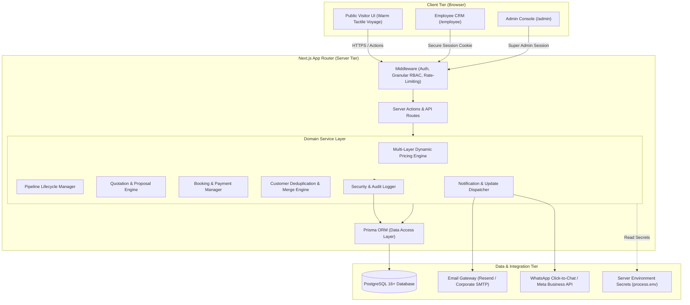
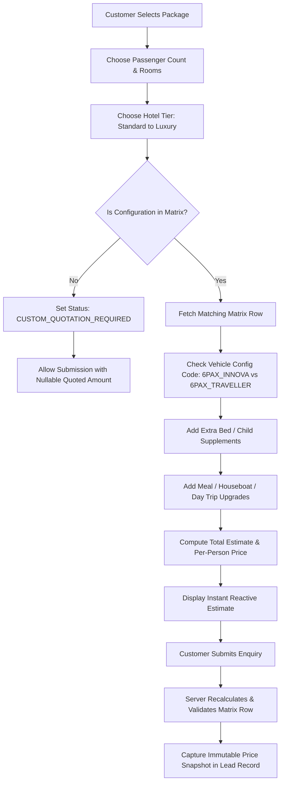
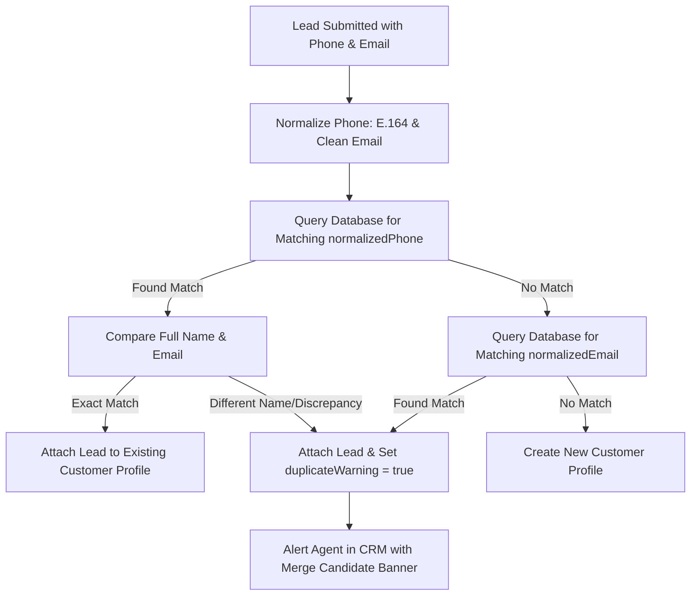
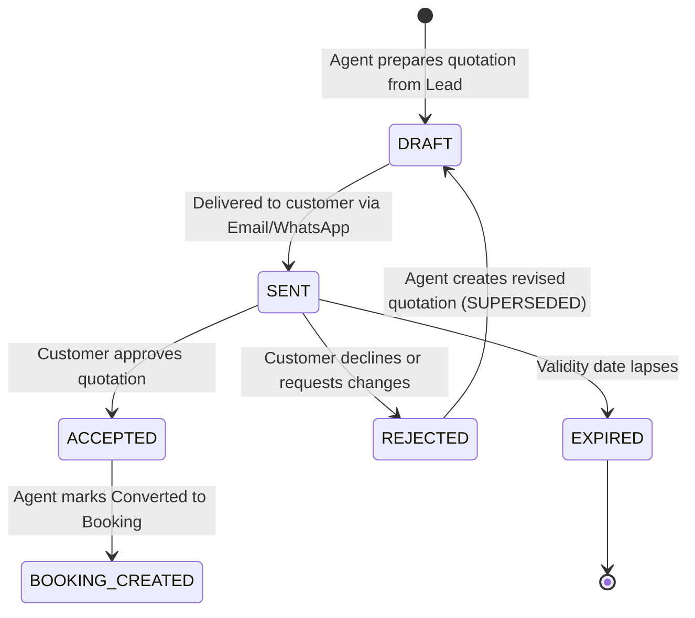
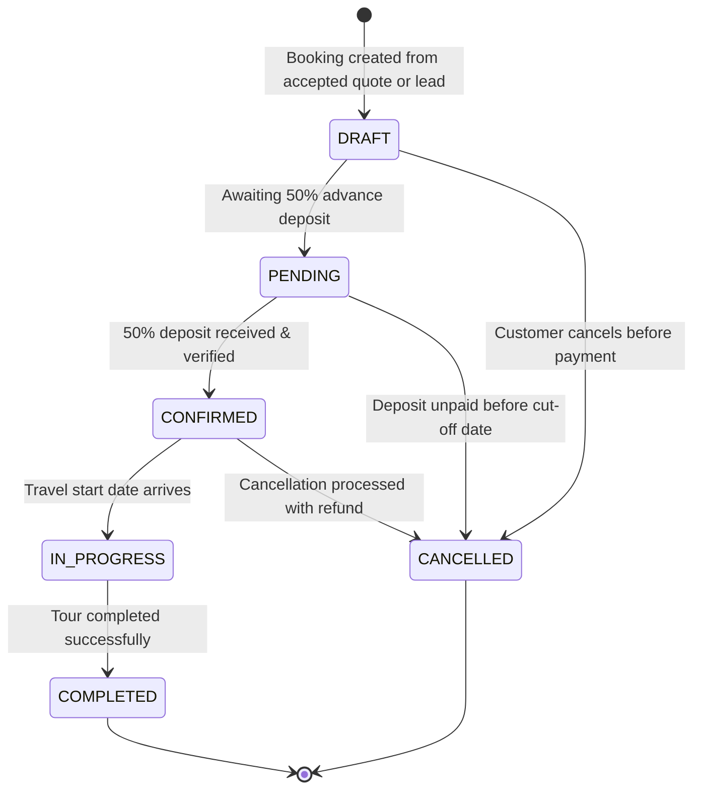
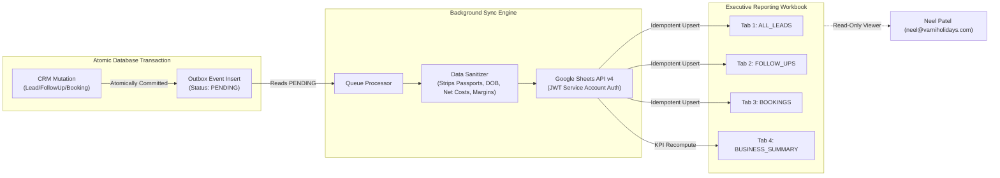

# SYSTEM ARCHITECTURE & TECHNICAL SPECIFICATION
**Project:** VARNI HOLIDAYS Travel Management Platform  
**Document Code:** ARCH-VH-02 (Revision 2 — Post Architecture Review)  
**Version:** 2.0 (Phase 0 Corrected Baseline)  
**Date:** 04 November 2026

---

## 1. Architectural Overview & Design Philosophy

The Varni Holidays platform is designed as an enterprise full-stack web application built on **Next.js App Router (React Server Components)**, **TypeScript**, **Tailwind CSS**, and **PostgreSQL with Prisma ORM**.

The system balances two distinct operational domains:
1. **Public Web Experience:** High-performance, responsive travel portal adhering to the *Warm Tactile Voyage* design system, engineered for search engine discoverability and seamless enquiry conversion.
2. **Internal Enterprise CRM (`/employee` and `/admin`):** A high-security, role-based operational workspace enabling travel agents and administrators to qualify leads, execute multi-layer pricing computations, generate formal quotations, manage service bookings, log interactions, and dispatch progress updates.

---

## 2. Security Architecture & Granular Access Control (RBAC)

### 2.1 Granular Permissions Matrix

To prevent unauthorized financial disclosure and operational cross-contamination, capabilities are managed via discrete permission codes rather than coarse role flags:

| Permission Code | Category | Public | Flights Agent | Packages Agent | Visa Agent | Super Admin (Neel Patel) |
| :--- | :--- | :---: | :---: | :---: | :---: | :---: |
| `VIEW_SUPPLIER_COSTS` | Finance | ❌ | ❌ | ❌ | ❌ | **✅ Full Access** |
| `MANAGE_PRICING_MATRICES` | Packages | ❌ | ❌ | ❌ | ❌ | **✅ Full Access** |
| `APPROVE_PRICING` | Packages | ❌ | ❌ | ❌ | ❌ | **✅ Full Access** |
| `VIEW_FLIGHT_ENQUIRIES` | Leads | ❌ | **✅ Assigned** | ❌ | ❌ | **✅ Full Access** |
| `VIEW_PACKAGE_ENQUIRIES` | Leads | ❌ | ❌ | **✅ Assigned** | ❌ | **✅ Full Access** |
| `VIEW_VISA_ENQUIRIES` | Leads | ❌ | ❌ | ❌ | **✅ Assigned** | **✅ Full Access** |
| `ASSIGN_LEADS` | Leads | ❌ | ❌ | ❌ | ❌ | **✅ Full Access** |
| `CHANGE_LEAD_STAGE` | Leads | ❌ | **✅ Assigned** | **✅ Assigned** | **✅ Assigned** | **✅ Full Access** |
| `CREATE_QUOTATIONS` | Quotes | ❌ | **✅ Assigned** | **✅ Assigned** | **✅ Assigned** | **✅ Full Access** |
| `MANAGE_BOOKINGS` | Bookings | ❌ | **✅ Assigned** | **✅ Assigned** | **✅ Assigned** | **✅ Full Access** |
| `RECORD_PAYMENTS` | Finance | ❌ | ❌ | ❌ | ❌ | **✅ Full Access** |
| `SEND_CUSTOMER_UPDATES` | Comms | ❌ | **✅ Assigned** | **✅ Assigned** | **✅ Assigned** | **✅ Full Access** |
| `MERGE_CUSTOMERS` | Customers | ❌ | ❌ | ❌ | ❌ | **✅ Full Access** |
| `EXPORT_FINANCIAL_REPORTS`| Reports | ❌ | ❌ | ❌ | ❌ | **✅ Full Access** |
| `EXPORT_CUSTOMER_DATA` | Reports | ❌ | ❌ | ❌ | ❌ | **✅ Full Access** |
| `ACCESS_PASSPORT_DOCS` | Compliance | ❌ | ❌ | ❌ | ❌ | **✅ Full Access** |
| `MANAGE_SYSTEM_SETTINGS` | System | ❌ | ❌ | ❌ | ❌ | **✅ Full Access** |

### 2.2 Security Mandates & Secret Management
1. **Zero Secrets in Database:** The `SystemSetting` table is strictly reserved for non-sensitive public metadata (office address, business hours, public phone, footer copyright). All API keys, database credentials, and email credentials reside in server-side environment secrets (`process.env.RESEND_API_KEY`, etc.).
2. **Server-Side Enforcement:** RBAC checks execute within server actions and API route guards. Frontend button suppression is cosmetic; unauthorized API calls receive HTTP 403 Forbidden.
3. **Session Security:** Session tokens are stored in `HttpOnly`, `Secure`, `SameSite=Strict` cookies. Expired or disabled accounts are immediately rejected.
4. **Data Isolation:** `supplierCostInr` and internal margins are strictly excluded from public JSON serializers and client-facing responses.

---

## 3. Multi-Layer Dynamic Tour Pricing Engine

The pricing engine delivers predictable, auditable, and instant price estimates without static hard-coding.

### 3.1 Five Discrete Financial Layers
1. **Supplier Cost (`supplierCostInr`):** Confidential B2B net operator rate from `Ready Packages` DOCX.
2. **Published Source Rack Rate (`sourceRackRateInr`):** Explicit rate printed in supplier rack rate catalogue. *Mandate:* Never recalculated via automated 15% formulas.
3. **Varni Approved Selling Price (`varniSellingPriceInr`):** Active customer-facing base price.
4. **Markup Amount (`markupAmountInr` & `markupPercent`):** Difference between selling price and supplier cost.
5. **Customer Quotation Amount (`quotedTotalPriceInr`):** Actual amount saved on customer proposal/enquiry.

### 3.2 Exact Group Matching & Non-Interpolation Rule
- **Both 6-Pax Configurations Preserved:**
  - `6PAX_INNOVA`: 6 Pax in Innova Crysta (3 Rooms) → Standard Rack Rate: **₹20,700/pax**
  - `6PAX_TRAVELLER`: 6 Pax in AC Tempo Traveller (3 Rooms) → Standard Rack Rate: **₹21,400/pax**
- **Unsupported Configurations:** If customer selects 3, 5, 7, or 9 passengers, the system does not interpolate. It sets `PricingStatus = CUSTOM_QUOTATION_REQUIRED`, sets `quotedUnitPriceInr = null`, and allows the customer to submit a bespoke quote request.
- **Price Immutability:** Upon enquiry submission, the active pricing matrix data and selected supplements are serialized into `PackageEnquiryDetail.priceSnapshotJson`. Modifying active package rates in the admin portal will never alter historical customer enquiry snapshots.

---

## 4. Customer Identity, Deduplication & Merge Engine

### 4.1 Deduplication & Merge Governance Rules
1. **No Unique Phone Constraint:** Multiple customer records may have identical phone numbers (family members, personal vs. corporate).
2. **Never Auto-Merge:** Automatic profile merging based on name or phone similarity is strictly prohibited.
3. **Audited Admin Merging:** When an admin reviews and executes a customer merge:
   - The subordinate customer has `mergedIntoCustomerId` populated and `isDeleted = true`.
   - `mergedAt` and `mergedByUserId` are recorded.
   - All historical leads, quotations, bookings, and activities remain attributable.

---

## 5. Flight Enquiry Engine: Multi-City & Segment Topology

To support One-way, Round-trip, and Multi-city routing cleanly without database compromises:
- `FlightEnquiryDetail` captures passenger counts (Adults, Children, Infants), cabin class, and special requirements.
- Routing is modeled via 1-to-many `FlightSegment` records:
  - **One-Way:** 1 segment (`segmentOrder = 1`, AMD → LHR).
  - **Round-Trip:** 2 segments (`segmentOrder = 1`, AMD → LHR; `segmentOrder = 2`, LHR → AMD).
  - **Multi-City:** N segments (`segmentOrder = 1`, AMD → DXB; `segmentOrder = 2`, DXB → LHR; `segmentOrder = 3`, LHR → AMD).

---

## 6. Quotation Lifecycle & Financial Structure

- Each quotation receives a unique human-readable reference: `VH-QUO-YYYYMM-XXXX`.
- Line items distinguish confidential supplier unit costs from customer billable amounts.
- Captures subtotal, taxes, fees, discounts, payment terms, and immutable price snapshots.

---

## 7. Booking & Payment Architecture

- **No Default Confirmation:** Bookings default to `DRAFT` or `PENDING`. Confirmation requires verified advance payment.
- **PaymentRecord Module:** Every payment transaction (Bank Transfer, UPI, Card, Cash, Cheque) is logged with transaction reference, status (`PENDING`, `COMPLETED`, `FAILED`, `REFUNDED`), and recording employee.
- **Service Components:** Booking components are categorized (`FLIGHTS`, `HOTELS`, `TRANSFERS`, etc.) with independent supplier and customer confirmation references.

---

## 8. Customer Communication & Delivery Tracking

### 8.1 Discrete Delivery Lifecycle States
1. `RECORD_CREATED`: Message composed and saved in CRM database.
2. `SEND_INITIATED`: Handover to outbound communication dispatcher.
3. `PROVIDER_ACCEPTED`: Email service (Resend) or WhatsApp BSP accepted the payload.
4. `SENT`: Message dispatched from mail/messaging server.
5. `DELIVERED`: Delivery receipt confirmed by recipient server/handset.
6. `FAILED`: Delivery failed (bounce, invalid phone number, rate limit).
7. `CLICK_TO_CHAT_TRIGGERED`: Employee clicked the `https://wa.me/` quick-contact link.

### 8.2 Strict Click-to-Chat Integrity Mandate
- A click on a `https://wa.me/` link opens the WhatsApp Web or mobile app on the employee's workstation.
- It provides no automated delivery confirmation from Meta.
- **Strict Rule:** Click-to-chat events are recorded as `CLICK_TO_CHAT_TRIGGERED`, and must **NEVER** be displayed or reported as `DELIVERED`.

---

## 9. Phase 2.1 Google Sheets Read-Only Live Business Reporting

### 9.1 Core Synchronization Philosophy
- **Sole Source of Truth:** PostgreSQL remains the solitary transactional system of record.
- **Strict One-Way Synchronization:** Data flows exclusively in one direction:
  `PostgreSQL Database → Transactional Outbox Queue → Background Sync Worker → Google Sheets API`.
- **Zero Inbound Edits:** Edits inside Google Sheets are strictly ignored and never imported into the CRM.
- **Viewer-Only Access for Executive:** Proprietor Neel Patel is provisioned with Google Sheets `Viewer` permissions. The dedicated backend service account holds `Editor` permissions to push data.
- **Outage Isolation:** A Google Sheets API outage, rate limit, or network failure is safely captured in the outbox queue with retry backoff and never interrupts customer enquiries or employee CRM operations.

### 9.2 Transactional Outbox Architecture

### 9.3 Four-Tab Workbook Specification
1. **`ALL_LEADS`:** 14 columns tracking live customer requirements, service categories, destinations, stages, and assigned specialists. Updates existing rows idempotently by Lead Reference ID.
2. **`FOLLOW_UPS`:** 7 columns tracking pending and completed client callback reminders.
3. **`BOOKINGS`:** 8 columns tracking confirmed customer bookings with travel dates and booking status milestones. Only verified bookings appear.
4. **`BUSINESS_SUMMARY`:** Real-time database-derived executive KPIs:
   - Funnel metrics (Total, Flight, Package, Visa, Requests, General, Priority, Converted, Closed).
   - Operational health (Pending follow-ups, overdue follow-ups, confirmed bookings).
   - Employee-wise conversion rates and active leads.
   - Service-wise conversion efficiency.
   - *Rule:* Estimated package quotation amounts are strictly never reported as actual revenue.

### 9.4 Strict Confidentiality Governance
The synchronization sanitizer strictly strips:
- Customer passport numbers and document attachments.
- Sensitive visa documents.
- Date of birth (DOB).
- Supplier net contracted rates.
- Travel agent gross margins and markup formulas.
- Customer payment credentials.
