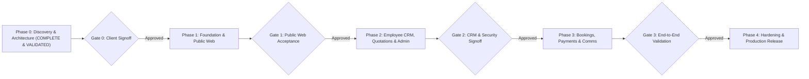

# IMPLEMENTATION ROADMAP & SPRINT EXECUTION PLAN
**Project:** VARNI HOLIDAYS Travel Management Platform  
**Document Code:** IRP-VH-02 (Revision 2 — Post Architecture Review)  
**Version:** 2.0 (Phase 0 Corrected Baseline)  
**Date:** 04 November 2026

---

## 1. Project Phasing & Release Gates

---

## 2. Detailed Phase & Sprint Breakdown

### Phase 0: Discovery, Source Audit & Architecture (STATUS: COMPLETED & VALIDATED)
- [x] Comprehensive workspace inspection of UI references, SRS specifications, DOCX supplier rate catalogues, and promotional flyers.
- [x] Extraction and mathematical audit of exact pricing layers for Kerala 6N/7D (preserving both 6-pax Innova and Traveller options).
- [x] Formulated Requirements Traceability Matrix connecting SRS IDs to target components.
- [x] Developed corrected PostgreSQL Prisma database schema with ERD, granular permissions, soft deletion, and non-unique phone deduplication.
- [x] **Validated Prisma Schema:** Syntactically verified using Prisma CLI (`The schema at schema.prisma is valid 🚀`).
- [x] Codified resolved architectural decisions (`AD-01` to `AD-14`) and remaining client decisions (`CQ-01` to `CQ-05`).

---

### Phase 1: Foundation, Public Website & Enquiry Engines
**Objective:** Deliver a production-grade, responsive public website that reflects the *Warm Tactile Voyage* Stitch UI and captures structured enquiries for Flights, Tour Packages, and Visa Assistance.

#### Sprint 1.1: Project Scaffolding & Design System Foundation
- Initialize Next.js 14+ App Router project in `/application/` with TypeScript and Tailwind CSS.
- Configure Tailwind tokens for Warm Tactile Voyage (`#153650`, `#24689B`, `#E9B95E`, `#F8F6F0`, `#F1EEE5`).
- Set up custom claymorphic elevation utilities (`shadow-clay-card`, `shadow-clay-inset`).
- Configure Google Fonts (`Playfair Display` and `Plus Jakarta Sans`) via `next/font`.
- Set up Prisma ORM with validated schema and seed baseline lookups (Roles, Granular Permissions, Hotel Tiers, Kerala 6N/7D Package).

#### Sprint 1.2: Public Layout & Homepage
- Build responsive floating brand header with navigation and contact CTAs.
- Implement editorial Hero Section with layered ambient glows and tactile visual canvas.
- Build Clay Search Widget for quick tour and destination discovery.
- Implement Curated Destinations Carousel and Featured Tour Packages.
- Build "Why Choose Us" trust grid, client testimonials, and Anand office footer.

#### Sprint 1.3: Flight Enquiry Engine (Segmented Topology)
- Build dedicated Flight Search interface supporting One-way, Round-trip, and Multi-city routing.
- Implement multi-segment input manager (`FlightSegment` records).
- Implement Airport/City autocomplete selector and date range picker.
- Build passenger counter (Adults, Children, Infants) and cabin class selector.
- Create Contact Capture Modal with country-aware phone validation.
- Implement server action to validate and persist Flight enquiry in `Requests` stage.

#### Sprint 1.4: Tour Packages & Multi-Layer Dynamic Pricing Engine
- Build Tour Package Listing page with destination, duration, and style filters.
- Build Package Details page with editorial gallery, highlights bento, and day-wise itinerary.
- Implement interactive Dynamic Pricing Calculator for Kerala 6N/7D:
  - Computes prices reactively across 5 hotel tiers and supported passenger counts (2, 4, 6, 8, 10 pax).
  - Preserves and toggles both 6-pax vehicle configurations (`6PAX_INNOVA` vs. `6PAX_TRAVELLER`).
  - Handles extra bed, child (CWB/CNB), meal plan (MAP/AP), and houseboat upgrade supplements.
  - Fallback: Unsupported passenger counts (3, 5, 7, 9 pax) set `PricingStatus = CUSTOM_QUOTATION_REQUIRED` with nullable price.
- Implement server-side revalidation and immutable price snapshot capture.

#### Sprint 1.5: Visa Assistance Module
- Build Visa Assistance landing page highlighting destinations and service process.
- Implement Visa Enquiry form capturing destination, visa type, purpose, and applicant count.
- Include legal disclaimer regarding assistance vs. issuance.
- Persist Visa enquiry in `Requests` stage.

---

### Phase 2: Internal Employee CRM, Quotations & Super Admin Portal
**Objective:** Deliver the operational workspace for lead qualification, pipeline progression, formal quotation generation, customer deduplication, and administrative control.

#### Sprint 2.1: Authentication & Granular Permissions
- Implement secure session authentication using HTTP-only cookies and bcrypt password hashing.
- Provision initial Super Admin account for Neel Patel.
- Enforce server-side granular permissions (`VIEW_SUPPLIER_COSTS`, `APPROVE_PRICING`, `EXPORT_FINANCIALS`, etc.).
- Restrict sensitive queues and prevent unauthorized role access.

#### Sprint 2.2: Employee CRM Pipeline
- Implement 4-stage pipeline board: **Requests → General → Priority → Converted/Booked** (plus Closed).
- Build Lead Card with quick stats, service badges, and urgency tags.
- Build comprehensive Lead Detail Drawer with original search context, activity log, and action toolbar.
- Implement stage transition modal with mandatory notes and timestamps.
- Build Follow-Up Scheduler with overdue and upcoming reminders.

#### Sprint 2.3: Customer Identity, Deduplication & Admin Merging
- Build customer deduplication engine searching across normalized phone and email.
- Display potential duplicate warning flags in CRM lead cards.
- Build auditable Admin Customer Merge tool with complete history preservation.

#### Sprint 2.4: Quotations & Proposal Management
- Build Quotation Composer to generate formal proposals (`VH-QUO-YYYYMM-XXXX`) from active leads.
- Implement quotation line-item editor distinguishing confidential supplier unit costs from customer selling prices.
- Track quotation lifecycle (`DRAFT`, `SENT`, `ACCEPTED`, `REJECTED`, `EXPIRED`, `SUPERSEDED`).
- Serialize immutable pricing snapshot upon quotation dispatch.

#### Sprint 2.5: Super Admin Control Center
- Build Admin Executive Dashboard with real-time enquiry counts, service split, and conversion rates.
- Implement Employee Management: create users, assign granular roles, deactivate accounts instantly.
- Build Package & Pricing Matrix Manager: manage supplier costs, source rack rates, selling prices, and markups.
- Implement Security Audit Log viewing and CSV/XLSX export functions.

---

### Phase 2.1: Google Sheets Read-Only Live Business Reporting (STATUS: COMPLETED & VERIFIED)
**Objective:** Deliver an automated, resilient, one-way Google Sheets synchronization pipeline enabling Neel Patel to view real-time executive business intelligence without CRM write-backs.

#### Scope & Architecture:
- [x] **PostgreSQL as Sole Source of Truth:** Guaranteed one-way data flow (`PostgreSQL → Transactional Outbox → Google Sheets`). Zero inbound spreadsheet edits.
- [x] **Four-Tab Executive Workbook Structure:**
  - `ALL_LEADS` (14 columns, idempotent updates by Lead Reference ID)
  - `FOLLOW_UPS` (7 columns, callback scheduling and completion audit)
  - `BOOKINGS` (8 columns, verified bookings only with status milestones)
  - `BUSINESS_SUMMARY` (Computed real-time KPIs, stage counts, employee and service conversion rates)
- [x] **Transactional Outbox Engine:** Atomic DB commit with sync job enqueueing; resilient retry backoff; zero operational interruption during Google API downtime.
- [x] **Google Service Account Authentication:** Official Google Sheets API v4 integration with JWT client authentication via server environment variables.
- [x] **Executive Access:** Dedicated service account holds Editor permission; Neel Patel provisioned with Read-Only Viewer access.
- [x] **Data Sanitization & Privacy:** Complete exclusion of passport documents, DOB, confidential supplier net rates, and agent markups.
- [x] **Admin Governance Console (`/admin/google-sheets`):** Live sync status, clickable spreadsheet URL, Manual "Sync Now", "Test Connection", "Retry Failed Jobs", and Outbox Queue audit table.
- [x] **Super Admin Dashboard Integration (`/employee/dashboard`):** "Open Business Google Sheet" executive action button and real-time Outbox Health monitoring widget.
- [x] **Automated Test Suite (`scripts/test-phase2-1-sheets.ts`):** 10/10 end-to-end tests passing cleanly.

---

### Phase 3: Bookings, Payments, Customer Updates & Communications (STATUS: COMPLETED & VERIFIED)
**Objective:** Bridge employee operations with post-conversion booking records, financial payment tracking, branded PDF proposals, and transparent customer communications via Resend Email and Meta WhatsApp.

#### Deliverables & Verified Features:
- [x] **Neon PostgreSQL Dual Connection:** Runtime pooled connection (`DATABASE_URL`) + Direct migration connection (`DIRECT_URL`) configured and verified.
- [x] **Modern SaaS Visual Theme:** Eliminated chunky Windows scrollbar buttons, replaced dirty cream with sleek Slate-50 background, Slate-900 navigation, and crisp accessible typography.
- [x] **Quotation Management Desk (`/employee/quotations`):** Itemized multi-service proposal composer with supplier net cost confidentiality, gross margin tracking, and status lifecycle.
- [x] **Branded PDF Quotation Preview (`/employee/quotations/[id]`):** High-resolution printable proposal with company letterhead, Anand Head Office address, GSTIN, itemized schedule, and HDFC Bank remittance details.
- [x] **Booking Operations Desk (`/employee/bookings`):** Strict business rule enforcement ensuring new bookings default to `PENDING` status. Automated creation of operational component service cards (Flights, Hotels, Visas, Transfers).
- [x] **Booking Command Center (`/employee/bookings/[id]`):** Independent service progress tracking, voucher/PNR registration, payment ledger, and customer update modal.
- [x] **Multi-Channel Communications (`lib/integrations/`):**
  - Resend Email Service with branded HTML templates across 12 update categories.
  - Meta WhatsApp Business Cloud API with strictly compliant fallback to click-to-chat (`CLICK_TO_CHAT_TRIGGERED`).
- [x] **Customer 360 Journey Timeline (`/employee/customers/[id]`):** Complete historical timeline uniting enquiries, follow-ups, quotations, bookings, service milestones, payments, and communications.
- [x] **Automated Test Suite (`scripts/test-phase3.ts`):** 12/12 end-to-end tests passing cleanly.
- [x] **Next.js Production Build:** 31 routes compiling with zero errors.
- Track discrete communication lifecycle (`RECORD_CREATED`, `SEND_INITIATED`, `PROVIDER_ACCEPTED`, `SENT`, `DELIVERED`, `FAILED`, `CLICK_TO_CHAT_TRIGGERED`).
- Enforce click-to-chat separation from delivered messaging metrics.
- Configure transactional email integration (Resend / SMTP).

---

### Phase 4: Testing, Security Hardening & Production Release
**Objective:** Validate system performance, execute security audits, optimize bundle size, and release to production.

#### Sprint 4.1: Quality Assurance & Acceptance Testing
- Run test scenarios AT-01 through AT-15 (Flight enquiry validation, pricing accuracy, RBAC security, payment records).
- Verify mobile responsiveness across standard viewports (390px, 768px, 1280px, 1440px).
- Verify zero regression against Stitch visual tokens.

#### Sprint 4.2: Security & Vulnerability Audit
- Perform penetration tests on RBAC endpoints to ensure zero unauthorized financial data leakage.
- Verify CSRF mitigation, parameterization, and input sanitization.
- Ensure supplier costs and internal margins are completely inaccessible to public visitors and regular agents.
- Confirm zero API keys or secrets are stored in database tables.

#### Sprint 4.3: Deployment & Handover
- Execute production database migrations on PostgreSQL.
- Seed baseline package data and Super Admin account.
- Configure environment variables and production logging.
- Deliver operating manuals for employees and Super Admin.

---

## 3. Database Migration Readiness Report

| Evaluation Category | Status | Verification Detail |
| :--- | :---: | :--- |
| **Prisma Schema Syntax** | **PASSED** | Verified with Prisma CLI (`The schema at schema.prisma is valid 🚀`). |
| **Referential Integrity** | **PASSED** | All foreign keys properly mapped with non-destructive `onDelete: Restrict` or `onDelete: SetNull`. |
| **Cascade Elimination** | **PASSED** | Zero destructive cascades on business records (`LeadActivity`, `CustomerUpdate`, `Quotation`, `Booking`, `PaymentRecord`). |
| **Index Optimization** | **PASSED** | Indexed fields: `Customer.normalizedPhone`, `Customer.normalizedEmail`, `Lead.stage`, `Lead.serviceType`, `PackagePricingMatrix(packageId, hotelTierId, minPax, vehicleConfigCode)`. |
| **Financial Precision** | **PASSED** | All currency amounts defined as `Decimal @db.Decimal(10, 2)`. Zero floating-point rounding errors. |
| **Security Isolation** | **PASSED** | `SystemSetting` restricted to non-sensitive text; secrets managed via server environment variables. |
| **Migration Execution** | **HOLD** | Kept on hold per explicit instruction. Schema is staged and verified, ready for migration command upon Phase 1 launch. |
