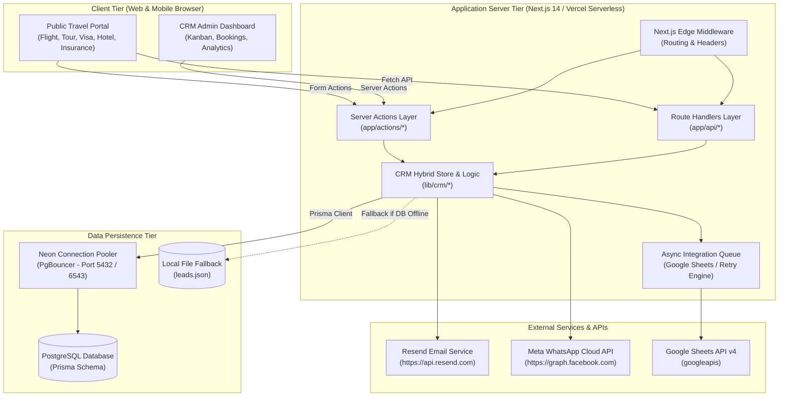
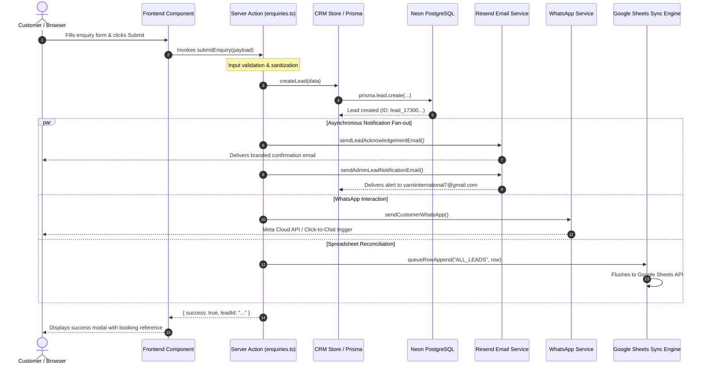

# Varni Holidays — API & Hosting Architecture

**Document Version:** 1.0.0  
**Generated Date:** November 2026  
**Audited Codebase:** Next.js 14 App Router (`application/`)

---

## 1. System Topology Overview

Varni Holidays is built on a modern **Next.js 14 App Router** architecture designed for cloud deployment on **Vercel** or containerized Node.js environments. The application utilizes a hybrid execution model combining Server Components, Server Actions, REST Route Handlers, and asynchronous external integrations.



---

## 2. Request Lifecycles & Data Flows

### 2.1 Public Enquiry Submission Flow

When a user submits an enquiry (e.g. Flight, Tour Package, Visa, or Travel Insurance):



---

## 3. Serverless Execution Environment Considerations

### 3.1 Vercel Serverless Function Lifecycle
* **Statelessness:** Serverless invocations are ephemeral. Each request may spin up a new container instance.
* **Timeout Constraints:** Default execution limit on Vercel Hobby is 10 seconds (60 seconds on Pro). All external API calls (Resend, Google Sheets, Meta) are executed concurrently with `Promise.allSettled` or handled non-blockingly to guarantee fast response times (< 800ms).
* **Cold Starts:** Node.js cold start times are minimized by using native `fetch` for Resend and Meta instead of heavy omnibus SDKs.

### 3.2 Database Connection Pooling with Neon PgBouncer
* In a serverless environment, hundreds of concurrent user requests can rapidly exhaust PostgreSQL's maximum connection limit.
* **Solution Implemented:**
  * `DATABASE_URL` connects through **PgBouncer** (port 5432/6543 with `?sslmode=require&pgbouncer=true`).
  * `application/lib/prisma.ts` implements a global singleton pattern (`globalThis.prisma`) in development to prevent duplicate connection pools during hot module reload (HMR).

### 3.3 Storage Resilience: Hybrid Store Pattern
* While `Prisma` is the primary persistence engine, the codebase incorporates an in-memory repository with file-persistence fallback (`application/lib/crm/store.ts`).
* **Serverless Caveat:** On serverless platforms (Vercel), the local filesystem is read-only (except `/tmp`). Therefore, production deployments rely on `Prisma` + `DATABASE_URL`. The local JSON store provides full offline functionality in local development and containerized Docker environments.

---

## 4. Planned WhatsApp Webhook Architecture

To support the upcoming two-way WhatsApp AI / Rule-based Chatbot, the following architecture is designed:

```mermaid
flowchart LR
    subgraph Meta_Cloud["Meta Infrastructure"]
        WA_User["WhatsApp User<br/>(Mobile App)"]
        Meta_Servers["Meta Cloud API Servers<br/>(Graph API v19.0)"]
    end

    subgraph Varni_Webhook["Varni Holidays Server"]
        WH_Route["POST /api/webhooks/whatsapp"]
        Sig_Verify["HMAC SHA-256<br/>Signature Verification"]
        Msg_Parser["Message & Event Parser<br/>(Text, Button, Quick Reply)"]
        Bot_FSM["Chatbot State Machine<br/>(Greeting, Destination, Dates, Passenger)"]
        Lead_Bridge["CRM Lead Generator<br/>(Prisma Lead Model)"]
    end

    WA_User -->|Sends Message| Meta_Servers
    Meta_Servers -->|Webhook Event (HTTPS POST)| WH_Route
    WH_Route --> Sig_Verify
    Sig_Verify -->|Valid| Msg_Parser
    Msg_Parser --> Bot_FSM
    Bot_FSM -->|Qualified Prospect| Lead_Bridge
    Bot_FSM -->|Reply Message| Meta_Servers
    Meta_Servers -->|Delivers Response| WA_User
```

### 4.1 Key Webhook Requirements
1. **Public HTTPS Endpoint:** Meta requires a publicly accessible HTTPS endpoint (e.g. `https://varnitours.com/api/webhooks/whatsapp` or ngrok for local development).
2. **GET Handshake Handler:** Must handle `hub.mode === 'subscribe'`, verify `hub.verify_token`, and return `hub.challenge` as plain text.
3. **POST Payload Signature Security:** Must compute `crypto.createHmac('sha256', process.env.WHATSAPP_APP_SECRET)` over raw request body and compare with `x-hub-signature-256` header using constant-time comparison (`crypto.timingSafeEqual`).
4. **Immediate `200 OK` Response:** Must return HTTP 200 within 3 seconds to avoid Meta retrying the delivery. Heavy processing (CRM lead creation, OpenAI/Gemini NLP, email alerts) must be executed asynchronously.

